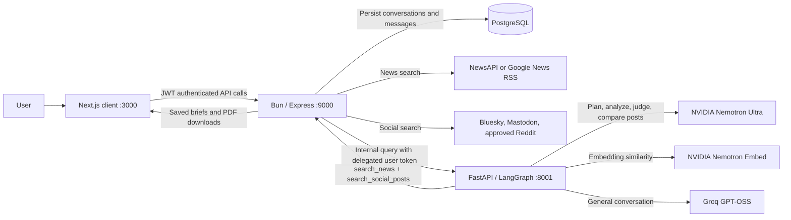

# NarrativeX

NarrativeX is a research workspace for comparing how news outlets and public social posts describe the same story. Ask a question to get a cited brief, inspect competing claims in an evidence graph, and follow how the framing changes across dated posts. Investigations are saved and can be exported for further review.

[Features](#main-capabilities) · [Research methods](#research-workspace) · [Evaluation](#evaluation-metrics) · [Local setup](#local-development) · [Verification](#verification) · [Roadmap](#research-roadmap)

## Project objective

The system is designed to help researchers, journalists, and curious readers:

- Search current reporting and public posts about a question or topic.
- Compare news and social narratives using closely aligned search terms.
- Identify claims, supporting and counter-evidence, relationships, and unanswered questions.
- Trace how emphasis and reported positions change across dated sources.
- Inspect the original sources, the retrieval coverage, and the evaluation method behind each brief.
- Save investigations and export their reports as PDFs.

Use a brief to locate original evidence and decide what to verify next. The strength of each conclusion depends on the sampled sources and the accuracy of the interpretation.

## Novelty and project contribution

NarrativeX brings several parts of narrative research into one traceable workflow:

1. **Paired cross-media collection.** One model-planned tool call chooses aligned queries and invokes both the news and social adapters. Evidence selection prioritizes a shared topic and reserves space for both media.
2. **Excerpt-backed comparisons.** The model cites numbered passages from the retrieved sample. The evaluator resolves those IDs against the original text and requires evidence from each medium before retaining a cross-media conclusion.
3. **Evidence graphs with verification actions.** Claim and comparison nodes lead back to cited passages. The verification queue turns missing citations, conflicting claims, and unresolved questions into follow-up investigations.
4. **Cited post-to-post analysis.** The timeline orders posts using source-reported timestamps and attaches an earlier and later excerpt to each retained interpretation of a change or repetition.
5. **Inspectable evaluation and provenance.** Each evaluated brief exposes its model judge, mathematical diagnostics, provider failures, and source list. The graph export carries the evidence snapshot and its hash. The PDF preserves the readable research record.

The project's contribution is the integration of paired retrieval, passage-level validation, visual evidence inspection, and export in one workflow.

## Main capabilities

| Area | What you can do |
| --- | --- |
| **Public site** | Explore the product, research workflow, and data sources on a responsive landing page with scroll reveals. Loading, error, and missing-page screens cover navigation failures. |
| **Account access** | Create an account or sign in with email and password. Google sign-in is available when configured. The workspace shows your name and profile image when available. A rejected session signs out and prompts you to sign in again. |
| **Intelligence Desk** | Browse world affairs, economy, technology, climate, science, and health. Search headlines and public posts with one topic, refresh feeds, and start an investigation from a story. Headline cards display publisher, date, and image when available. |
| **World Watch** | Explore geopolitical headlines on a map. Markers use the first matching keyword's city coordinates as a geographic cue for browsing. |
| **Research Studio** | Start from a suggested prompt or a question of your own. Open, rename, and delete saved investigations. Press Enter to submit or Shift+Enter / Ctrl+Enter for a new line. Incomplete runs preserve the question and any returned evidence. |
| **Research brief** | Read the news-versus-social findings, claim assessments, relationships, exact excerpts, evaluation tables, and retrieval limitations. Expand a response to full screen or copy the brief. API responses and clipboard actions provide toast feedback. |
| **Evidence Workspace** | Switch between the inference graph, source network, and verification queue. Search and select evidence, inspect node and edge details, maximize the graph, and export its JSON. |
| **Social narrative timeline** | Read dated posts in order, compare their framing, and review the two source excerpts behind each retained transition. The timeline remains visible in full-screen responses and readable exports. |
| **PDF export** | Download the entire saved conversation from its title bar. The server formats headings, lists, tables, quotations, and source links into a paginated report. |

To try the research workflow, open **Research Studio** and ask “Compare news and social coverage of AI regulation. Where do the narratives agree, and how does the framing change across dated posts?” Read the brief, select a finding in the Evidence Workspace, inspect its quotes, then use the verification queue to draft a follow-up.

## Architecture

| Application | Default port | Responsibilities |
| --- | ---: | --- |
| `client/` | `3000` | Next.js, React, Tailwind CSS, NextAuth, dashboard, chat, Markdown and graph rendering |
| `server/` | `9000` | Bun/Express API, JWT authentication, PostgreSQL persistence through Prisma, provider adapters, in-memory cache |
| `service/` | `8001` | FastAPI/LangGraph routing, model tool planning, structured analysis, evaluation and metrics |



Express is the browser's data API and owns authentication, provider access, and persistence. Protected routes verify the NarrativeX JWT. Conversation and report handlers scope database lookups to the authenticated user. FastAPI receives the research request from Express and uses the delegated JWT for its news and social tool calls. PostgreSQL stores users, conversations, and messages. Provider credentials remain in the backend services.

### Research request flow

1. **Save the question.** Express verifies the conversation owner and stores the user message before calling the AI service with the question and prior conversation text.
2. **Route the request.** LangGraph uses a keyword-based router. General conversation goes to Groq GPT-OSS. Questions about evidence, news, social media, or timelines enter the research workflow.
3. **Plan and retrieve.** Nemotron Ultra selects bounded parameters for `compare_news_and_social`. The tool calls `search_news` and `search_social_posts` concurrently through Express. Provider adapters normalize responses, cache results, and keep partial failures alongside successful results.
4. **Select and analyze evidence.** The evaluator deduplicates source URLs and selects up to eight documents, aiming for a balance of news and social evidence. TF-IDF similarity helps rank relevance to the question and alignment with the other medium. Nemotron Ultra returns structured comparisons, claims, relationships, and unknowns using numbered excerpts.
5. **Validate and evaluate.** The service resolves and checks excerpts, computes citation and retrieval metrics, runs a separate judge pass, and analyzes the selected dated social posts. The graph derives from validated evidence. When the model fails, the service can retry on a smaller sample or return source leads and any available timeline.
6. **Store and review.** Express saves the generated message. Research Studio renders the report, timeline, evaluation tables, and evidence graph. Copy and PDF use the readable report text, and graph export uses the saved evidence artifact.

The planner supplies search parameters to fixed tools. Express validates the inputs before requests reach data providers.

## Research Workspace

### Claim analysis and cross-media comparisons

Each brief compares the news and social positions on a shared topic. The model can report agreement, partial agreement, disagreement, a difference in emphasis, or insufficient evidence. It also assesses individual claims as supported, disputed, misleading, unverified, or insufficiently evidenced within the selected sample.

The evaluator resolves numbered passages to exact, contiguous excerpts in retrieved titles and text. It discards absent quotations, downgrades claims missing the required support or counter-evidence, and marks comparisons with a missing media type as insufficient. An exact match verifies attribution. Researchers can use the quoted context to assess whether it justifies the model's stance or relationship.

### Evidence graph and verification queue

- **Trace evidence:** news and social source nodes connect to claim and comparison nodes through citation edges. Selecting a node shows its full text or rationale, source attribution, timestamp, and original URL.
- **Inspect disagreement:** directed claim relationships show the model's rationale. Counter-citations and contradiction links use dashed edges. Relationship labels and directions are available in the inspector and keyboard-accessible node list.
- **Prioritize verification:** a deterministic queue identifies uncited claims, claims citing only one media class, missing counter-evidence, comparisons missing valid news/social citations, and model-inferred contradictions to review. A queue action drafts a follow-up question in the existing composer for the researcher to review and submit.
- **Export for analysis:** download graph JSON with nodes, edges, verification tasks, selected source documents, the query, generation time, and a SHA-256 hash of the evidence snapshot. Completed analyses also retain the model ID and evaluation details.

Graph construction uses the validated structured analysis and retrieved URLs. Citation edges connect findings to retrieved references. Claim relationships express the model's interpretation. Establishing influence, transmission, causation, or political affiliation requires additional evidence.

The design draws on research into evidence-graph reasoning for fact-checking and on the provenance concepts of attribution and derivation. [Semantic-level graph reasoning](https://aclanthology.org/2020.acl-main.549/) · [W3C PROV-O](https://www.w3.org/TR/prov-o/)

The server saves a version-1 graph artifact in a `narrativex-graph` Markdown fence. The client validates it before rendering the graph. Copy, PDF export, and model history use the readable text. Older messages without an artifact render as text.

### Social narrative timeline

The timeline takes the social posts from the brief's selected evidence and orders usable timestamps in UTC. It compares adjacent posts on the same issue and labels repetition, added detail, reframing, or a challenge. Each retained result includes the exact earlier and later excerpts and links to the original posts. Equal timestamps leave the relative order unknown. Coverage counts show how many selected posts had usable timestamps and text and how many adjacent pairs were interpreted.

The chronological list remains available if the interpretation call fails. It can also render when the news side is missing and the social side still has dated evidence. The timeline uses a bounded, query-selected sample. Estimating population trends or tracing transmission requires broader dated sampling or explicit interaction records. [Sequential stance analysis](https://aclanthology.org/C16-1230/) · [Longitudinal semantic analysis](https://aclanthology.org/2024.findings-emnlp.193/)

## Models

Model IDs are defined in [`service/config/models.py`](service/config/models.py). Provider keys are configured in the service environment.

| Role | Model | Use |
| --- | --- | --- |
| Research search planner | `nvidia/nemotron-3-ultra-550b-a55b` | Chooses the aligned topic and bounded parameters for the paired tools |
| Evidence analyzer, judge, and timeline | `nvidia/nemotron-3-ultra-550b-a55b` | Produces structured findings, separately evaluates the brief, and classifies post-to-post transitions |
| Embeddings | `nvidia/nemotron-3-embed-1b` | Measures query/source and claim/evidence cosine similarity |
| General conversation | `openai/gpt-oss-120b` through Groq | Answers requests routed as general conversation without retrieval |

When the embedding provider is unavailable, the metrics service uses local TF-IDF and identifies the active backend in the report. Cosine similarity measures topical alignment. Entailment and accuracy require a separate assessment.

## Evaluation metrics

Each evaluated research brief contains an **Evaluation** table and an **Evidence diagnostics** table in chat and PDF. If the judge fails, the brief retains deterministic metrics and identifies model scores as unavailable. If the analysis itself fails, the fallback brief explains the failure and lists available research leads.

### LLM-judge assessments

All judge scores range from `0` to `1`. They are model estimates based on the request, the selected source documents, and the structured analysis:

| Measure | What it assesses |
| --- | --- |
| Groundedness | Whether findings are supported by the supplied source material |
| Answer relevance | Whether the brief addresses the user's request |
| Completeness | Whether key requested comparison points are covered |
| Source quality | The usefulness and reliability of the retrieved sources |
| Comparison quality | Whether both news and social positions are represented accurately and cited |

The judge is a separate pass using the configured analysis model. Read its scores alongside the excerpts and judge notes.

### Deterministic quality checks

| Measure | Calculation | Interpretation |
| --- | --- | --- |
| Claim citation validity | Valid claim/counter-evidence URLs ÷ all cited claim URLs | Whether claim citations point to documents in the evaluated set |
| Comparison citation validity | Comparisons with valid news and social URLs ÷ all comparisons | Whether each cross-media comparison is backed by both source classes |
| Claim evidence coverage | Claims with at least one valid citation ÷ all claims | Fraction of claims connected to retrieved evidence |
| Cross-media coverage | `1` when both news and social are in the evaluated set, otherwise `0` | Presence of both media types in the sample |
| Cross-media balance | `2 × min(news count, social count) ÷ total evaluated documents` | `1` indicates an even split between the two media |

The internal **Weighted quality score** combines these judge and deterministic measures as follows:

```text
25% groundedness
+ 15% answer relevance
+ 10% completeness
+ 10% source quality
+ 10% comparison quality
+ 10% claim citation validity
+ 10% claim evidence coverage
+ 10% comparison citation validity
```

Citation and coverage ratios use zero when their denominator is empty. The weighted score is a per-brief composite of the checks above. Interpreting it as a probability or measuring factual accuracy would require calibration and reference labels.

### Evidence diagnostics

| Diagnostic | Calculation/use | Important limit |
| --- | --- | --- |
| Query/evidence cosine | Mean cosine similarity between the request and evaluated documents | Measures topical alignment |
| News/query and social/query cosine | Mean request-to-document cosine, shown separately by media type | Helps reveal topical imbalance between the two evidence groups |
| Claim/evidence cosine | Mean of each cited claim's best cosine against its supporting or counter-cited documents | The brief identifies the vector backend |
| Source diversity | Normalized Shannon entropy across source-type and publisher labels | Describes variety in the sampled labels |
| Document redundancy | Mean pairwise vector cosine between documents | Similar articles can be legitimate corroboration or duplicate coverage |
| Multi-source citation rate | Share of claims with supporting citations from at least two distinct source labels | Independence requires checking the original reporting |
| Temporal span | Time between the oldest and newest evaluated timestamps | Describes the sample window; missing timestamps reduce its coverage |

The timeline reports dated-post and interpreted-pair counts separately from the research quality score. Accuracy, retrieval recall, and semantic correctness across versions require a human-reviewed reference set.

Evaluation practice follows the distinction between reference-based accuracy and reference-free groundedness/relevance assessments described in [NVIDIA NeMo Agent Toolkit](https://docs.nvidia.com/nemo/agent-toolkit/latest/workflows/evaluate.html) and [RAGAS metric guidance](https://docs.ragas.io/en/stable/concepts/metrics/available_metrics/).

## Sources and data limitations

| Source | Current access method | Credentials |
| --- | --- | --- |
| NewsAPI | Search `/v2/everything`. The adapter returns available headlines, descriptions, dates, publishers, and images. [NewsAPI documentation](https://newsapi.org/docs/endpoints/everything) | `NEWS_API_KEY` |
| Google News RSS | Fallback when the NewsAPI key is missing or its search fails or returns no articles | Public RSS |
| Bluesky | Latest-first public post search through `app.bsky.feed.searchPosts`. [Bluesky search contract](https://github.com/bluesky-social/bsky/blob/main/lexicons/app/bsky/feed/searchPosts.json) | Public endpoint |
| Mastodon | Hashtag discovery and public hashtag timelines on `mastodon.social`. [Mastodon timeline API](https://docs.joinmastodon.org/methods/timelines/#tag) | Public endpoints on the configured instance |
| Reddit | Manual topic search from the dashboard. An optional application-only OAuth adapter runs with approved access. [Reddit Data API access](https://support.reddithelp.com/hc/en-us/articles/14945211791892-Developer-Platform-Accessing-Reddit-Data) | Approved access flag, client ID, client secret, and descriptive user agent |

Bluesky and Mastodon are the default social sources. Mastodon coverage depends on discoverable hashtags and the instance's public timeline. Bluesky coverage depends on its search index. The server returns available posts alongside per-provider errors. News and geopolitical query results are cached for 15 minutes and social search for five minutes in the Express process.

**Search on Reddit** opens a topic search for manual review in a new tab. Automated Reddit collection is gated by `REDDIT_APPROVED_ACCESS=true` and valid credentials. The separate Reddit for Researchers program offers academic access under its own approval and data rules. Review the permissions for collection, model processing, storage, and export before enabling the adapter. [Reddit developer access](https://support.reddithelp.com/hc/en-us/articles/14945211791892-Developer-Platform-Accessing-Reddit-Data) · [Reddit for Researchers](https://support.reddithelp.com/hc/en-us/articles/49381918834964-Reddit-for-Researchers-Program)

Research uses a single bounded collection per investigation and up to eight selected documents. The report may contain article excerpts and public posts visible to the provider. Broader observations require a defined collection period, repeated sampling, and evidence about which sources and dates the queries covered.

## API surface

Express data routes accept `Authorization: Bearer <NarrativeX JWT>`. NextAuth uses the auth routes to establish the browser session.

| Method and path | Access | Purpose |
| --- | --- | --- |
| `GET /health` | Public | Check that Express is responding |
| `POST /api/auth/signup` | Public | Create a credentials account |
| `POST /api/auth/signin` | Public | Sign in and receive the server JWT |
| `POST /api/auth/google` | Public | Exchange the profile sent by the NextAuth callback for a NarrativeX account and JWT |
| `POST /api/auth/signout` | Public | Acknowledge sign-out. NextAuth handles the browser session |
| `GET /api/news/search?q=...` | JWT | Search normalized news articles |
| `POST /api/social/search` | JWT | Search social providers with `topics`, optional `platforms`, and `limit` |
| `GET /api/events/geopolitics?limit=...` | JWT | Return keyword-matched headlines for the dashboard map |
| `GET/POST /api/conversation` | JWT | List or create a user's conversations |
| `PUT /api/conversation/rename/:conversationId` | JWT | Rename an owned conversation |
| `DELETE /api/conversation/:conversationId` | JWT | Delete an owned conversation and its messages |
| `GET/POST /api/conversation/chat/:conversationId` | JWT | Load messages or submit a question and receive a saved report |
| `GET /api/conversation/report/:conversationId` | JWT | Export a conversation report as PDF |
| `POST /api/agent/query` on port `8001` | Service-to-service | Run the AI workflow for Express |
| `GET /health` on port `8001` | AI service | Check that FastAPI is responding |

For social search, the server accepts a body like:

```json
{
  "topics": ["AI regulation"],
  "platforms": ["bluesky", "mastodon"],
  "limit": 10
}
```

The social response returns normalized `posts` and per-provider `errors`. Omit `platforms` to select the server defaults. Each request accepts up to ten topic strings, each up to 100 characters, and a `limit` from 1 to 25.

## Local development

The native workflow uses Bun for the client and API, Python 3.12 in the Conda environment `narrativex-venv`, and an external PostgreSQL database. Run the commands below from the repository root unless a code block changes directories.

### Configure the environment

Copy the templates on a fresh checkout. Keep your existing files when updating a configured checkout.

```bash
cp client/.env.example client/.env
cp server/.env.example server/.env
cp service/.env.example service/.env
```

| File | Required settings for the selected workflow | Optional settings |
| --- | --- | --- |
| [Client template](client/.env.example) | A private `NEXTAUTH_SECRET`. Use `NEXT_PUBLIC_HTTP_SERVER_BASE_URL=http://localhost:9000` for the native API. | `GOOGLE_CLIENT_ID`, `GOOGLE_CLIENT_SECRET`, and `NEXTAUTH_URL` for the public client origin when needed |
| [Server template](server/.env.example) | `DATABASE_URL` and a private `JWT_SECRET`. Set `MICROSERVICE_BASE_URL=http://localhost:8001` for the native AI service. | `PORT`, `NEWS_API_KEY`, and the approved Reddit settings in the template |
| [Service template](service/.env.example) | `NVIDIA_API_KEY` for research or `GROQ_API_KEY` for general chat. Set both for the full workflow. Use `SERVER_BASE_URL=http://localhost:9000` for authenticated retrieval. | `PORT`, `HOST`, `ALLOWED_ORIGINS`, and Nemotron generation settings in the model configuration |

Use separate private random values for the server JWT and NextAuth secrets. For Google sign-in, register `http://localhost:3000/api/auth/callback/google` as an authorized redirect URI and use the equivalent callback on the actual client origin if it differs. [NextAuth Google provider](https://next-auth.js.org/providers/google) · [NextAuth options](https://next-auth.js.org/configuration/options#nextauth_url)

### Prepare PostgreSQL and start the services

Start each service in its own terminal. Point `DATABASE_URL` at your development database and verify that it satisfies the Prisma contract. For a fresh database, review the proposed schema changes in the dry run before applying them.

```bash
cd server
bun install --frozen-lockfile
bun run contract:emit
bun run db:update --dry-run
bun run db:update
bun run db:sign --no-advance-ref
bun run dev
```

```bash
cd service
conda create -n narrativex-venv python=3.12
conda run -n narrativex-venv python -m pip install -r requirements.txt
conda run --no-capture-output -n narrativex-venv python app.py
```

```bash
cd client
bun install --frozen-lockfile
bun run dev
```

Reuse `narrativex-venv` if you already created it. The client is at `http://localhost:3000`, the API at `http://localhost:9000`, and the AI service at `http://localhost:8001`. The AI port leaves `8000` available for VA POC.

For a remote PostgreSQL server that requires TLS, use the connection details provided by the host. NarrativeX normalizes the PostgreSQL client modes `prefer`, `require`, and `verify-ca` to `verify-full` to preserve certificate and hostname verification. [Prisma contract](server/src/prisma/contract.prisma) · [Server configuration](server/src/lib/config.ts)

## Docker Compose (optional)

[Docker Compose](docker-compose.yml) builds the three application services from the Dockerfiles in [`docker/`](docker/). Prepare the same database and service settings as for native development, with these networking differences.

- Use a `DATABASE_URL` reachable from the server container. The database is supplied separately.
- Set `NEXT_PUBLIC_HTTP_SERVER_BASE_URL` in the shell or Compose's root `.env` so it is available at build time, and match it in `client/.env`. Use an API URL reachable from both the browser and the client container, because NextAuth also uses it for server-side calls. A browser's `localhost` and a container's `localhost` refer to different hosts.
- Compose sets Express-to-AI traffic to `http://service:8001` and AI-to-Express tool calls to `http://server:9000`. External access uses the published client and API ports, `3000` and `9000` by default. Override them with `CLIENT_HOST_PORT` and `SERVER_HOST_PORT` and update the external URLs accordingly.

```bash
docker compose up --build
```

The Compose layout keeps FastAPI on the application network. For a public deployment, enforce provider identity verification on the Express Google account exchange. The current exchange relies on the NextAuth callback for that verification.

## Verification

Run the Express provider, controller, and PDF tests and build the server.

```bash
cd server
bun test
bun run build
```

Run the Python tests for research tooling, evidence validation, graph construction, metrics, and the social timeline.

```bash
cd service
conda run -n narrativex-venv python -m unittest discover -s tests -v
```

Check graph artifact parsing, client lint, and the production build.

```bash
cd client
bun test scripts/research-graph.test.ts
bun run lint
bun run build
```

The [public UI smoke](client/scripts/ui-smoke.mjs) and [dashboard smoke](client/scripts/dashboard-smoke.mjs) export Playwright routines. The dashboard routine uses a test session and intercepted data API responses. The `/health` routes on the API and AI service check process availability. An authenticated research question exercises retrieval, model access, persistence, and the workspace together.

### Provider-backed research diagnostic

Run this from the repository root with a configured NVIDIA key.

```bash
cd service
conda run --no-capture-output -n narrativex-venv python verify_research.py
```

The [diagnostic](service/verify_research.py) classifies the first comparison in each of [five synthetic cases](service/tests/research_cases.json) covering agreement, negation, numerical conflict, scope conflict, and unrelated topics. It reports per-label precision and recall and macro-F1. A provider failure exits nonzero and records completed cases without an aggregate score. This protocol measures the configured analyzer on the fixture cases. Live retrieval coverage and real-world accuracy require separate evaluations.

On November 25, 2026, a live Research Studio investigation retrieved news and social evidence for the EU AI Act and displayed matching framing in two Bluesky posts thirteen days apart. The first analysis timed out and completed on retry. Mobile, full-screen, and PDF checks preserved the dated comparison and both excerpts. A separate controlled NVIDIA probe classified a direct contradiction. These checks cover specific workflows and examples. See the [timeline test cases](service/tests/test_social_timeline.py) for deterministic coverage.

## Research roadmap

The current timeline compares adjacent posts in the brief's selected evidence. The next proposed version follows the same claim across intervening posts and gives researchers better visibility into the sampling window.

1. **Timeline-specific retrieval.** Query a small set of fixed date windows, record provider coverage and failures, and deduplicate by stable post ID. Bluesky's search timestamps can differ from record creation times. Mastodon hashtag timelines use ID pagination. Window assignment should use validated post timestamps. [Bluesky search contract](https://github.com/bluesky-social/bsky/blob/main/lexicons/app/bsky/feed/searchPosts.json) · [Mastodon timelines](https://docs.joinmastodon.org/methods/timelines/#tag)
2. **Track a claim across time.** Shortlist nonadjacent mentions with lexical and semantic similarity, then verify proposition, scope, dates, and negation before linking them. Keep publication time separate from the date mentioned in a claim. [When Claims Evolve](https://aclanthology.org/2025.findings-acl.1150/) · [MultiClaimNet](https://aclanthology.org/2025.findings-emnlp.599/)
3. **Link timeline and graph inspection.** Show news and social evidence on parallel lanes in the Evidence Workspace. Selecting a transition opens both excerpts using the same source IDs. Explicit reply, quote, or repost metadata could support separate interaction edges. [newsLens](https://aclanthology.org/W17-2701/)
4. **Evaluate changes on held-out events.** Compare against the current adjacent-post method using human-labeled examples. Measure same-claim link precision and recall, relation macro-F1, excerpt attribution, reviewer agreement on the interpretation, and abstention coverage. Include corrections, repeated copies, missing dates, and unrelated posts between relevant mentions. [RumourEval](https://aclanthology.org/S19-2147/)

## Project layout

```text
client/
  src/app/                   Pages, NextAuth, and dashboard routes
  src/components/dashboard/  Intelligence Desk, chat, graph, and timeline UI
  src/lib/                   API client, Markdown, and artifact parser
  scripts/                   Browser smokes and artifact parsing test
server/
  src/routes/                API routes and auth boundary
  src/controllers/           Account, feed, conversation, and report handlers
  src/services/              Provider adapters, caching, AI client, and PDF rendering
  src/prisma/                PostgreSQL contract and runtime client
service/
  agents/                    LangGraph routing and research tool planning
  tools/                     Authenticated calls to the Express API
  models/ and config/        Provider adapters, model IDs, and prompts
  schemas/ and services/     Evidence, timeline, graph, judging, and metrics
  tests/                     Unit tests and labeled diagnostic fixtures
docker/                      Client, API, and AI service Dockerfiles
docker-compose.yml            Application service wiring
```
